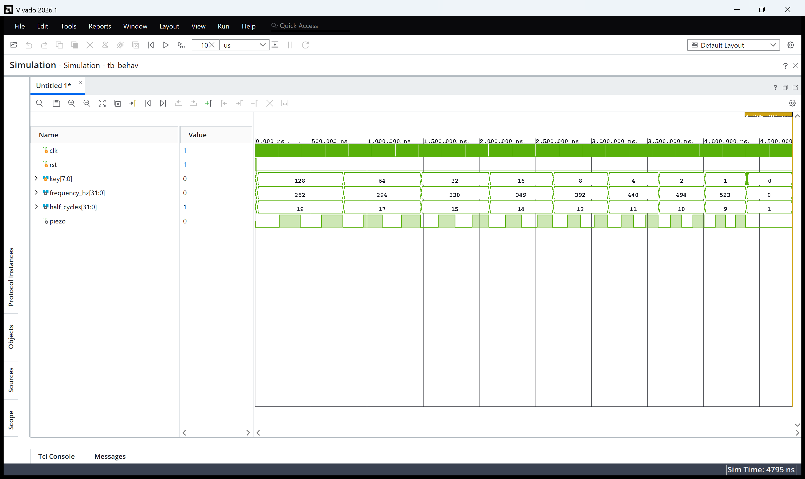
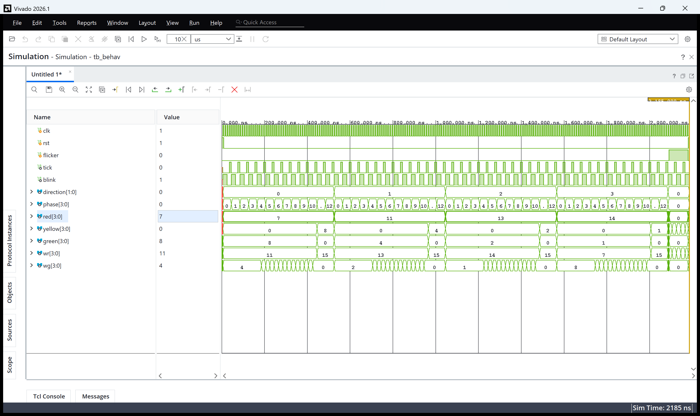
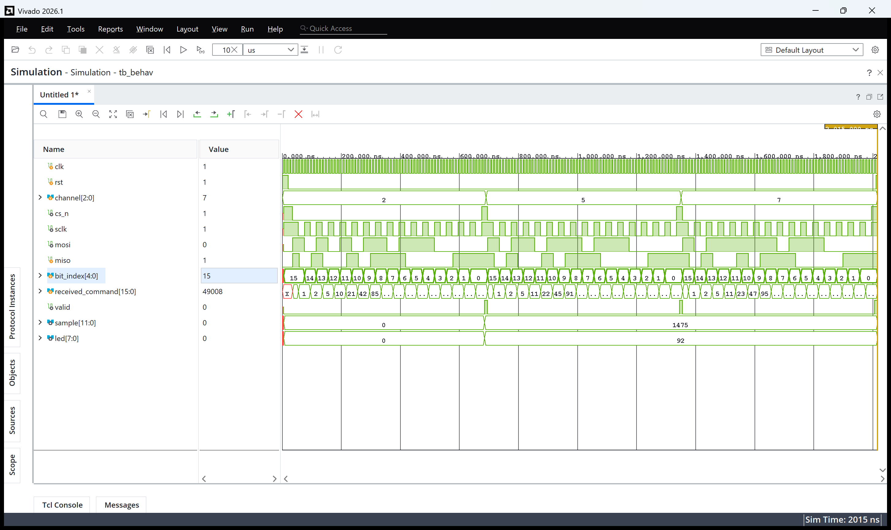

# 실험 후 레포트: 피아노, 신호등 제어, ADC (STM32_1 FPGA 교재 실습)

작성일 2026-10-21. 실험일 2026-10-19.

[실험 전 레포트](../pre/01_piano_traffic_adc.md) · [Vivado 빌드 스크립트](../../tools/vivado_build.tcl) · [파형 캡처 스크립트](../../tools/capture_vivado_wave.ps1)

## Vivado GUI 과정과 사전 결과 비교

Vivado 2026.1에서 설계별로 `piano`, `traffic`, `adc` 세 프로젝트를 만들었습니다. 타깃 부품은 Spartan-7 `xc7s75fgga484-1`입니다. 프로젝트 생성과 소스 등록은 [tools/vivado_build.tcl](../../tools/vivado_build.tcl)로 수행하고, 생성된 `vivado/<설계>/<설계>.xpr`를 GUI로 열어 보드 다운로드를 진행했습니다.

| 구분 | 피아노 | 신호등 제어 | ADC |
|---|---|---|---|
| Design Sources | `piano.v`, `note_select.v`, `square_tone.v` | `traffic.v`, `second_tick.v`, `traffic_sequence.v`, `traffic_lights.v` | `adc.v`, `adc_command.v`, `serial_frame16.v`, `adc_board.v` |
| Simulation Sources | `tb_piano.sv` | `tb_traffic.sv` | `tb_adc.sv` |
| Constraints | [piano.xdc](../../constraints/piano.xdc) | [traffic.xdc](../../constraints/traffic.xdc) | [adc.xdc](../../constraints/adc.xdc) |
| 설계 최상위 | `piano` | `traffic` | `adc_board` |
| 시뮬레이션 최상위 | `tb` | `tb` | `tb` |

ADC는 보드에 연결할 곳이 없는 `sample[11:0]`, `data_valid` 출력을 내부에 두는 보드용 최상위 `adc_board`를 추가했습니다. 세 테스트벤치 모두 모듈 이름이 `tb`이므로 설계별로 프로젝트를 나누었습니다.

Vivado Simulator(XSim)로 행동 시뮬레이션을 실행한 결과는 다음과 같습니다.

| 설계 | Vivado XSim 로그 | 종료 시각 | VS Code (Icarus Verilog) 사전 결과 |
|---|---|---|---|
| 피아노 | [`PASS piano: all 8 tones, silence, multiple keys, reset`](../../evidence/vivado/piano_simulation.log) | 4,796 ns | [동일 PASS](../../evidence/vscode/piano_sim_log.txt), 4,796 ns |
| 신호등 제어 | [`PASS traffic: full cycle, pedestrian blink, flicker, reset`](../../evidence/vivado/traffic_simulation.log) | 2,186 ns | [동일 PASS](../../evidence/vscode/traffic_sim_log.txt), 2,186 ns |
| ADC | [`PASS ADC: 3 serial frames, command bits, sample, reset`](../../evidence/vivado/adc_simulation.log) | 2,016 ns | [동일 PASS](../../evidence/vscode/adc_sim_log.txt), 2,016 ns |

세 설계 모두 두 시뮬레이터의 PASS 메시지와 `$finish` 시각이 같았습니다.

### Vivado 파형 해석

Vivado 파형 창의 값은 10진수(unsigned)로 표시했습니다. 캡처는 `$finish` 직전 시각까지 실행한 화면입니다.

- `key`가 128(`8'h80`, 도) → 64 → 32 → … → 1(`8'h01`, 높은 도)로 바뀔 때 `frequency_hz`가 262 → 294 → 330 → 349 → 392 → 440 → 494 → 523으로, `half_cycles`가 19 → 17 → 15 → 14 → 12 → 11 → 10 → 9로 바뀝니다(시뮬레이션 `CLK_HZ = 10,000`).
- 높은 음일수록 `piezo` 사각파의 주기가 짧아지고, 마지막 `key = 0` 구간은 `frequency_hz = 0`이라 `piezo`가 0으로 유지됩니다(무음).

- `tick`마다 `phase`가 0 → 12로 증가하고 12 다음에 `direction`이 0 → 1 → 2 → 3 → 0으로 넘어갑니다.
- direction 0에서 `green = 8`(1000, 남), `red = 7`(0111)이고, phase 11~12에서 `yellow = 8`로 바뀝니다. 방향이 바뀔 때마다 초록이 8 → 4 → 2 → 1(남 → 북 → 서 → 동)로 이동합니다.
- 보행자 초록 `wg`는 phase 0~3에 켜져 있다가 4~10에서 `blink`에 맞춰 깜빡이고, phase 11~12에는 `wr = 15`(모두 빨강)가 됩니다.
- 끝부분 `flicker = 1` 구간에서 빨강·초록이 0이 되고 노랑과 보행자 빨강이 함께 점멸합니다.

- `channel`이 2 → 5 → 7로 바뀌는 세 프레임 동안 `cs_n`이 LOW인 구간마다 `sclk`가 16번 토글하고 `bit_index`가 15 → 0으로 줄어듭니다.
- 수정한 `serial_frame16`에서는 `mosi`가 `sclk` 상승 에지에서만 바뀌어, AD7908이 명령을 읽는 하강 에지에서 안정되어 있습니다.
- 첫 프레임이 끝나면 `sample = 1475`(16진수 `5C3`), `led = 92`(16진수 `5C`)가 저장되어, 응답 `16'hA5C3`의 하위 12비트와 그 상위 8비트가 정확히 들어갔습니다.

## 합성·구현·bit

Run Synthesis → Run Implementation → Generate Bitstream을 실행해 세 설계 모두 `write_bitstream completed successfully`를 확인했습니다. 빌드 로그와 비트스트림을 보관했습니다.

| 설계 | 생성 파일 | SHA-256 | WNS / WHS | Slice LUT | 레지스터 | 사용 IOB |
|---|---|---|---|---:|---:|---:|
| 피아노 | [piano.bit](../../evidence/vivado/piano.bit) · [빌드 로그](../../evidence/vivado/piano_build.log) | `c8a47646…a0eddfa` | +14.284 / +0.265 ns | 646 | 43 | 11 |
| 신호등 | [traffic.bit](../../evidence/vivado/traffic.bit) · [빌드 로그](../../evidence/vivado/traffic_build.log) | `13695e09…7d9291b` | +15.033 / +0.247 ns | 32 | 32 | 27 |
| ADC | [adc_board.bit](../../evidence/vivado/adc_board.bit) · [빌드 로그](../../evidence/vivado/adc_build.log) | `1aa21b60…383b122` | +15.290 / +0.169 ns | 59 | 67 | 17 |

- **타이밍**: 세 설계 모두 50 MHz(주기 20.000 ns) 클록 제약에서 Setup·Hold 여유가 양수이고 실패한 경로가 없습니다.
- **피아노 자원**: LUT 646개로 다른 설계보다 많은 것은 반주기 `CLK_HZ / (2 × 주파수)`가 32비트 나눗셈 조합회로로 합성되기 때문입니다. 주파수는 8가지뿐이므로 반주기 값을 표로 미리 계산해 두면 크게 줄일 수 있습니다.
- **핀 배치**: 키패드(SW_1~SW_8 = K4·N8·N4·N1·P6·N6·L5·J2, `*` = L7), 피에조 Y21, 신호등 LED 24개(교재 핀 표), AD7908 SPI(H3·H5·J6·H7), DIP 스위치, LED1~8이 XDC대로 `LVCMOS33`으로 할당되었습니다.
- **경고**: 세 설계 모두 DRC `CFGBVS-1`(Bank 0 전압 속성 미지정) 하나만 남았습니다. 보드 회로도로 확인하지 않은 전압값을 임의로 넣지 않았으며 비트스트림 생성과 보드 동작에는 문제가 없었습니다.

## 보드 기록·촬영 상태

Combo II-DLD S75 보드에서 클록 스위치를 F(50 MHz), KEYPADS SEL을 Button Switch로 두고, Hardware Manager의 Auto Connect로 `xc7s75`에 각 비트스트림을 다운로드했습니다.

### 피아노 (`piano.bit`)

[피아노 시연 영상](../../evidence/board/videos/piano_demo.mp4)

| 조작 | 기대 동작 | 관찰 결과 | 사진 |
|---|---|---|---|
| 키 입력 없음 | 무음 | 소리 없음 | |
| 키패드 1~8을 차례로 누름 | 도 레 미 파 솔 라 시 도 순으로 높아짐 | 누르는 키마다 다른 높이의 음이 순서대로 출력됨 | [키 누름](../../evidence/board/photos/piano_key.jpg) |

- PIEZO ENABLE을 ON으로 두고 시연했습니다. 키마다 반주기 카운트가 다르게 선택되어 음 높이가 바뀌는 것을 확인했습니다.

### 신호등 제어 (`traffic.bit`)

[신호등 시연 영상](../../evidence/board/videos/traffic_demo.mp4)

| 시점(영상) | 관찰 결과 | 사진 |
|---|---|---|
| 약 3초 | 한 방향의 차량 초록과 해당 보행자 횡단보도 초록이 켜지고 나머지 방향은 빨강 | [초록·보행자](../../evidence/board/photos/traffic_green_walk.jpg) |
| 약 31초 | 다음 방향으로 초록이 넘어가고 해당 횡단보도가 초록 | [다음 방향](../../evidence/board/photos/traffic_next_direction.jpg) |
| 약 44초 | 또 다른 방향의 횡단보도 초록 점등 | [보행자 초록](../../evidence/board/photos/traffic_walk_green.jpg) |

- 초록 → 노랑 → 다음 방향 순서와 보행자 초록 점등 후 점멸이 시뮬레이션과 같은 순서로 반복되었습니다. 교재 핀 표의 극성(출력 1 = 켜짐)대로 LED가 동작했습니다.

### ADC (`adc_board.bit`)

[ADC 시연 영상](../../evidence/board/videos/ADC_demo.mp4)

| 채널 | 조작 | LED1~LED8 (실측) | 값 | 사진 |
|---|---|---|---:|---|
| ch0 (CdS) | 조명 그대로 | 1110_1111 | 239 | [CdS](../../evidence/board/photos/adc_cds.jpg) |
| ch1 (가변저항) | 한쪽으로 돌림 | 0000_1101 | 13 | [가변저항 낮음](../../evidence/board/photos/adc_pot_low.jpg) |
| ch1 (가변저항) | 반대쪽으로 돌림 | 1111_1001 | 249 | [가변저항 높음](../../evidence/board/photos/adc_pot_high.jpg) |

- CdS 센서를 손으로 가리면 LED 값이 바뀌었고, 가변저항을 돌리면 13 근처에서 249 근처까지 연속으로 변했습니다.
- **보드에서 발견한 문제와 수정**: 처음에는 CdS(ch0)만 반응하고 DIP 스위치로 ch1을 골라도 가변저항에 반응하지 않았습니다. AD7908 데이터시트를 확인한 결과 칩은 DIN을 SCLK **하강 에지**에서 읽는데, 수업 원본 `serial_frame16`은 바로 그 순간 MOSI를 바꾸어 채널 선택 명령이 전달되지 않았습니다. MOSI를 상승 에지에서 바꾸고 MISO를 하강 에지 직전에 읽도록 고친 뒤 테스트벤치 ADC 모델도 데이터시트 타이밍(DIN 셋업 10 ns·홀드 5 ns 검사)으로 바꾸었습니다. 원본 코드는 수정된 테스트벤치에서 `ADC DIN hold violation`으로 실패해 보드 증상이 재현되었고, 수정 코드는 PASS했으며 보드에서도 채널 선택이 정상 동작했습니다.

## 결론

STM32_1 주차 FPGA 실습 세 가지(피아노, 신호등 제어, AD7908 ADC 제어)를 VS Code Icarus Verilog와 Vivado XSim에서 같은 PASS 결과로 검증하고, Spartan-7(`xc7s75fgga484-1`)에서 50 MHz 클록 제약을 만족하는 비트스트림을 생성해 Combo II-DLD S75 보드에서 시연했습니다. 키패드에 따른 8음 출력, 4방향 신호등과 보행자 신호 순서, CdS·가변저항 전압의 8비트 변환값 LED 표시를 확인했습니다. 특히 ADC는 시뮬레이션 모델이 실제 칩과 다른 에지에서 데이터를 주고받아 보드에서만 드러난 타이밍 문제를 데이터시트로 원인 분석해 수정했고, 테스트벤치도 실제 칩 타이밍을 검사하도록 보완했습니다.
