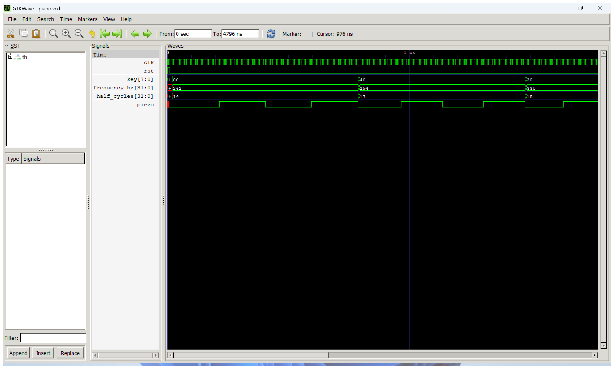
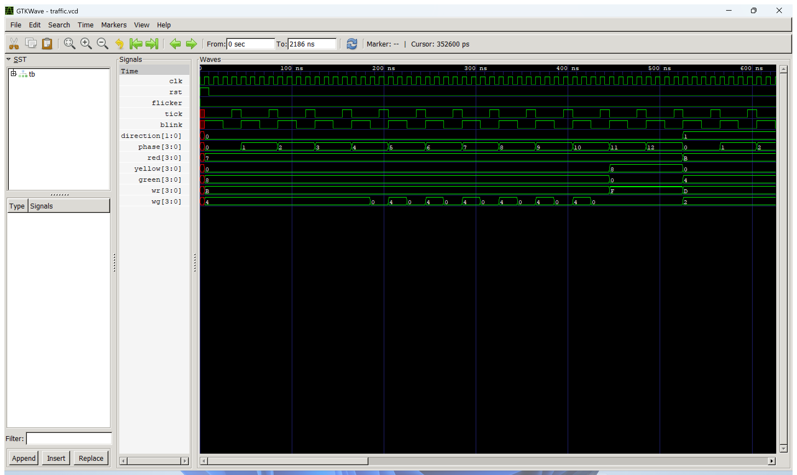
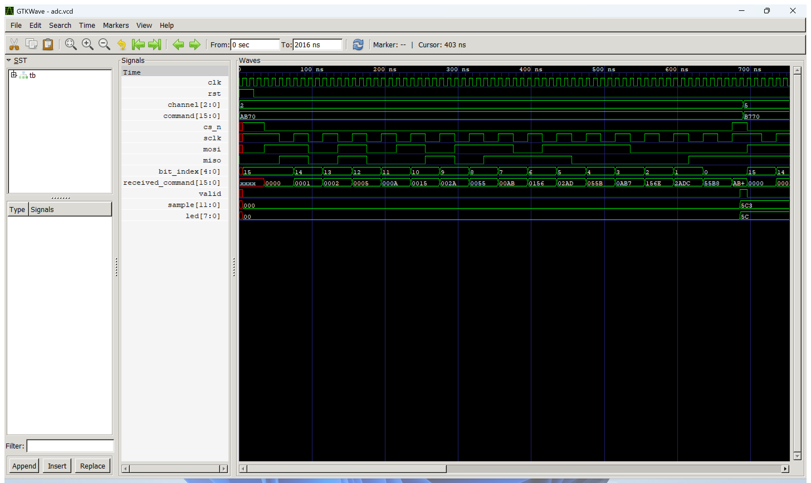

# 실험 전 레포트: 피아노, 신호등 제어, ADC (STM32_1 FPGA 교재 실습)

작성일 2026-10-18.

## 1. 목적과 핵심 파라미터 계산

### 실험 목적
STM32_1 주차의 FPGA 교재 실습으로, 50 MHz 클록에 동기화된 세 개의 순차회로를 설계하고 검증한다.
- **피아노(`piano`)**: 8개의 키 입력 중 하나가 눌리면 해당 음(도~높은 도)의 주파수를 가진 50% 듀티 사각파를 피에조로 출력한다. `note_select`가 키를 주파수로 바꾸고, `square_tone`이 주파수에 맞는 반주기마다 출력을 반전한다.
- **신호등 제어(`traffic`)**: 네 방향 교차로의 차량 신호(빨강·노랑·초록·좌회전)와 보행자 신호(빨강·초록)를 1초 단위로 제어한다. `second_tick`이 1초 tick과 0.5초 점멸 신호를, `traffic_sequence`가 방향과 단계를, `traffic_lights`가 LED 출력을 만든다.
- **ADC(`adc`)**: FPGA가 보드의 외부 8채널 12비트 직렬 ADC에 16비트 명령을 보내 채널을 고르고, 같은 프레임에서 변환 결과 16비트를 받아 하위 12비트를 `sample`로 저장한다. `adc_command`가 채널 선택 명령을, `serial_frame16`이 SPI 형식의 16비트 송수신(SCLK·CS·DIN·DOUT)을 담당하며, `sample`의 상위 8비트를 LED에 표시한다. STM32의 ADC가 아니라 FPGA가 외부 변환 장치를 제어하는 실습이다.

세 설계 모두 느린 동작을 새 클록으로 만들지 않고, 50 MHz 클록 안에서 카운터와 한 클록 길이의 tick으로 처리한다. 이번 레포트는 Icarus Verilog 시뮬레이션으로 기능을 먼저 확인하고, 보드 시연은 5장의 계획에 따라 실험 시간에 수행한다.

### 핵심 파라미터 계산
1. **피아노 반주기 카운트 (`half_cycles`)**:
   - 50% 듀티 사각파는 반주기마다 출력을 반전하므로
     $$\text{half\_cycles} = \left\lfloor \frac{f_{\mathrm{clk}}}{2 f_{\mathrm{note}}} \right\rfloor,\qquad f_{\mathrm{out}} = \frac{f_{\mathrm{clk}}}{2\,\text{half\_cycles}}$$
   - 보드($f_{\mathrm{clk}} = 50\text{ MHz}$)와 시뮬레이션(`CLK_HZ = 10,000`) 값은 다음과 같다.

   | key | 음 | 목표 주파수 (Hz) | 보드 half_cycles | 보드 실제 주파수 (Hz) | 시뮬레이션 half_cycles | 시뮬레이션 실제 주파수 (Hz) |
   |:---:|---|---:|---:|---:|---:|---:|
   | `8'h80` | 도 (C4) | 262 | 95,419 | 262.00 | 19 | 263.2 |
   | `8'h40` | 레 (D4) | 294 | 85,034 | 294.00 | 17 | 294.1 |
   | `8'h20` | 미 (E4) | 330 | 75,757 | 330.00 | 15 | 333.3 |
   | `8'h10` | 파 (F4) | 349 | 71,633 | 349.00 | 14 | 357.1 |
   | `8'h08` | 솔 (G4) | 392 | 63,775 | 392.00 | 12 | 416.7 |
   | `8'h04` | 라 (A4) | 440 | 56,818 | 440.00 | 11 | 454.5 |
   | `8'h02` | 시 (B4) | 494 | 50,607 | 494.00 | 10 | 500.0 |
   | `8'h01` | 도 (C5) | 523 | 47,801 | 523.00 | 9 | 555.6 |

   - 50 MHz에서는 나눗셈의 버림 오차가 0.01 Hz 미만이라 목표 주파수가 그대로 나온다. 시뮬레이션은 시간을 줄이려고 클록을 10 kHz로 낮춘 것이라 높은 음일수록 오차가 커지지만, 테스트벤치는 같은 식으로 기대값을 계산하므로 반전 시점 검사에는 영향이 없다.
   - 반주기 카운터 최댓값 95,418은 $2^{17} = 131,072$보다 작으므로 17비트면 충분하다(설계는 32비트 `reg`).
   - 키가 하나도 눌리지 않았거나 두 개 이상 눌리면 `frequency_hz = 0`이 되어 출력이 0(무음)으로 유지된다. 주파수가 바뀌는 순간에는 카운터와 출력을 0으로 초기화해 새 음이 항상 같은 위상에서 시작한다.

2. **신호등 1초 tick과 점멸 (`second_tick`)**:
   - `count`가 0부터 $f_{\mathrm{clk}} - 1 = 49,999,999$까지 세고, 마지막 값에서 `tick`이 한 클록 동안 1이 된다 → 1초에 한 번.
   - `blink = (count < CLK_HZ/2)` → 앞 0.5초 1, 뒤 0.5초 0인 1 Hz 점멸 신호.
   - 카운터 최댓값 49,999,999는 $2^{26} = 67,108,864$보다 작으므로 26비트면 충분하다.

3. **신호등 단계 (`traffic_sequence`, `traffic_lights`)**:
   - 한 방향의 단계 `phase`는 0~12의 13단계(13초)이며, 12 다음에 `direction`이 다음 방향으로 넘어간다. 네 방향 한 바퀴는 $4 \times 13 = 52$초이다.

   | phase (초) | 차량 신호 (현재 방향) | 다른 방향 차량 | 보행자 신호 (현재 방향의 보행자) |
   |:---:|---|---|---|
   | 0 ~ 3 | 초록 (+ 좌회전) | 빨강 | 초록 점등 |
   | 4 ~ 10 | 초록 (+ 좌회전) | 빨강 | 초록 점멸 (1 Hz) |
   | 11 ~ 12 | 노랑 | 빨강 | 빨강 |

   - 방향별 LED 마스크: direction 0 → 차량 `1000`, 보행자 `0100` / 1 → `0100`, `0010` / 2 → `0010`, `0001` / 3 → `0001`, `1000`.
   - 차량 초록 11초 + 노랑 2초, 보행자 초록 점등 4초 + 점멸 7초.
   - `flicker = 1`인 동안은 점멸 모드로, 모든 차량 빨강·초록과 보행자 초록을 끄고 노랑과 보행자 빨강만 1 Hz로 함께 점멸한다. 점멸 모드를 끄면 direction 0, phase 0부터 다시 시작한다.

4. **ADC 직렬 클록과 프레임 (`serial_frame16`)**:
   - SCLK는 `HALF_CYCLES` 클록마다 반전하므로
     $$f_{\mathrm{SCLK}} = \frac{f_{\mathrm{clk}}}{2 \times \text{HALF\_CYCLES}} = \frac{50\text{ MHz}}{2 \times 25} = 1\text{ MHz}$$
   - 한 프레임은 16비트 × 2 × 25 = 800클록 = 16 µs이고, 프레임 사이 대기 1~2클록을 더하면 초당 약 62,000번 변환 결과를 읽는다.
   - SCLK는 HIGH에서 대기하고, 하강 에지에서 FPGA가 명령 비트(MOSI = ADC DIN)를 내보내며, 상승 에지에서 ADC 출력(MISO = ADC DOUT)을 받는다. 비트 순서는 최상위 비트부터(MSB first)이다.
   - 시뮬레이션은 `HALF_CYCLES = 2`(SCLK 12.5 MHz)로 줄여 한 프레임을 64클록(640 ns)으로 만든다.

5. **ADC 명령 워드 (`adc_command`)**:
   - `command = {3'b101, channel, 2'b11, 1'b0, 3'b111, 4'b0000}` — 원본 예제의 쓰기(WRITE)·순차(SEQ)·채널 주소(ADD2~0)·전원 모드(PM1·PM0)·범위(RANGE)·코딩(CODING) 비트 배치를 유지한다.
   - 채널 값이 비트 [12:10]에 들어가므로 `command = 16'hA370 | (channel << 10)`이다. 예: channel 2 → `16'hAB70`, channel 5 → `16'hB770`, channel 7 → `16'hBF70`.
   - 수신 워드의 하위 12비트가 변환 결과이므로 $0 \sim 4095$ 범위이고, LED에는 상위 8비트 `sample[11:4]`(0~255)를 표시한다. 기준 전압을 $V_{\mathrm{REF}}$라 하면 1 LSB는 $V_{\mathrm{REF}} / 4096$, LED 1단계는 $V_{\mathrm{REF}} / 256$이다.

---

## 2. 파일 구성과 역할

| 경로 | 파일명 | 역할 및 설명 |
|---|---|---|
| `piano/` | `note_select.v` | `key[7:0]`(HIGH 활성, 하나만 눌림)을 음의 주파수(Hz)로 변환. 무입력·여러 키는 0 |
| `piano/` | `square_tone.v` | `CLK_HZ / (2 × 주파수)` 반주기마다 `tone`을 반전하는 사각파 발생기. 주파수가 바뀌면 카운터 초기화 |
| `piano/` | `piano.v` | 설계 최상위(Design Top). `note_select`와 `square_tone` 연결, 출력 `piezo` |
| `piano/` | `tb_piano.sv` | 시뮬레이션 최상위(`tb`). `CLK_HZ=10000`으로 8개 음의 반전 시점, 여러 키, 무음, 리셋 자기 검증 |
| `piano/` | `piano.gtkw` | GTKWave 신호 배치(`key`, `frequency_hz`, `half_cycles`, `piezo`) |
| `traffic/` | `second_tick.v` | 1초 `tick`(1클록 폭)과 1 Hz `blink` 생성 |
| `traffic/` | `traffic_sequence.v` | `tick`마다 `phase` 0~12 증가, 12 다음 `direction` 증가. 리셋·점멸 모드에서 0으로 초기화 |
| `traffic/` | `traffic_lights.v` | 방향·단계·점멸 상태로 차량(빨강·노랑·초록)과 보행자(빨강·초록) LED 4개씩 결정 |
| `traffic/` | `traffic.v` | 설계 최상위(Design Top). 세 모듈 연결, 좌회전 `led_left`는 초록과 같게 출력 |
| `traffic/` | `tb_traffic.sv` | 시뮬레이션 최상위(`tb`). `CLK_HZ=4`로 네 방향 13단계 × 4클록, 보행자 점멸, 점멸 모드, 리셋 자기 검증 |
| `traffic/` | `traffic.gtkw` | GTKWave 신호 배치(`tick`, `blink`, `direction`, `phase`, LED 출력) |
| `adc/` | `adc_command.v` | 3비트 채널 번호로 16비트 ADC 제어 명령 생성 |
| `adc/` | `serial_frame16.v` | 16비트 직렬 송수신(SCLK HIGH 대기, 하강 에지 송신, 상승 에지 수신, MSB first) |
| `adc/` | `adc.v` | 설계 최상위(Design Top). 프레임을 연속으로 시작하고 수신 하위 12비트를 `sample`, 상위 8비트를 `led_out`으로 출력 |
| `adc/` | `tb_adc.sv` | 시뮬레이션 최상위(`tb`). ADC 직렬 응답 모델로 3개 프레임의 명령·채널·수신값·LED·리셋 자기 검증 |
| `adc/` | `adc.gtkw` | GTKWave 신호 배치(`cs_n`, `sclk`, `mosi`, `miso`, `bit_index`, `sample`, `led`) |
| `constraints/` | `piano.xdc` | 피아노 보드 핀 제약(클록 B6, 키패드 1~8, 리셋 *, 피에조 Y21) |
| `tools/` | `vivado_build.tcl` | Vivado 프로젝트 생성 → XSim 시뮬레이션 → 합성·구현·비트스트림 |
| 루트 | `run_sim.bat` | `iverilog -g2012` 컴파일 → `vvp` 실행 → (옵션) GTKWave 실행 |
| 루트 | `capture_wave.ps1` | GTKWave 창을 띄워 전체·확대 파형을 `evidence/vscode/`에 PNG로 저장 |
| `.vscode/` | `tasks.json` | VS Code `Tasks: Run Task`로 두 시뮬레이션을 실행 |

설계·테스트벤치 코드는 [Glaysia/ece2_474 `docs/FPGA_additional.md`](https://github.com/Glaysia/ece2_474/blob/v1.1.0/docs/FPGA_additional.md)의 3·4·7번 실습 코드를 사용했으며, 파형 확인을 위해 각 TB에 `$dumpfile`/`$dumpvars` 한 줄만 추가했다.

---

## 3. 테스트벤치 자극과 기대 결과

세 TB 모두 10 ns 주기 클록을 쓰고, 입력은 클록 하강 에지에서 바꾸며 출력은 상승 에지 1 ns 뒤에 읽는다. 기대값과 다르면 `$fatal`로 즉시 중단하고, 모두 통과하면 `PASS` 메시지를 출력한다. 100 µs 안에 끝나지 않으면 `timeout`으로 실패 처리한다.

### 피아노 (`CLK_HZ = 10,000`)

| 검사 순서 | 인가 자극 | 기대 결과 | 판정 기준 및 검증 의미 |
|:---:|---|---|---|
| 1 | `select_key = 8'h80 >> n` (n = 0~7) | `frequency_hz` = 262, 294, …, 523 | `note_select` 음계 표 검사 |
| 2 | `key`를 새 음으로 바꾼 직후 | `piezo = 0` | 주파수가 바뀌면 출력이 0에서 새로 시작 |
| 3 | 같은 키 유지, 4 × half_cycles 클록 | half_cycles 클록마다 `piezo` 반전 (2주기) | 8개 음 각각의 반주기 길이 검사 |
| 4 | `key = 8'hC0` (두 키 동시) | `piezo = 0`, `frequency_hz = 0` | 여러 키 입력은 무음 |
| 5 | `key = 0`, 40클록 | `piezo = 0` 유지 | 무입력 무음 |
| 6 | `rst = 1` | `piezo = 0` | 리셋 |

### 신호등 제어 (`CLK_HZ = 4`, 1 tick = 4클록 = 40 ns)

| 검사 순서 | 인가 자극 | 기대 결과 | 판정 기준 및 검증 의미 |
|:---:|---|---|---|
| 1 | 리셋 해제 후 4방향 × 13단계 × 4클록 (208클록) | 매 클록 위 표의 차량·보행자 LED와 일치 | 전체 순서, 방향 전환, 노랑 2단계 |
| 2 | phase 4~10의 각 단계 앞 2클록 / 뒤 2클록 | 보행자 초록 켜짐 / 꺼짐 | 1 Hz 보행자 초록 점멸 |
| 3 | 매 클록 | `led_left === led_green` | 좌회전 표시 |
| 4 | `flicker = 1`, 8클록 | 빨강·초록·보행자 초록 = 0, 노랑 = 보행자 빨강 = `0000` 또는 `1111` | 점멸 모드 |
| 5 | `flicker = 0`, `rst = 1` | direction 0, phase 0 출력 | 리셋 후 처음 상태 |

### ADC (`HALF_CYCLES = 2`, 1비트 = 4클록 = 40 ns)

TB 안의 ADC 모델은 `cs_n` 하강 에지에서 프레임을 시작하고, SCLK 하강 에지마다 응답 `16'hA5C3`을 최상위 비트부터 내보내며, SCLK 상승 에지마다 MOSI 명령 비트를 받는다.

| 검사 순서 | 인가 자극 | 기대 결과 | 판정 기준 및 검증 의미 |
|:---:|---|---|---|
| 1 | 리셋 중 | `cs_n = 1`, `sclk = 1`, `sample = 0` | 리셋 상태에서 SCLK HIGH 대기 |
| 2 | channel 2로 첫 프레임 | 16비트 수신, 명령 `16'hAB70` | 프레임 길이와 채널 비트 위치 |
| 3 | `valid` 상승 | `sample = 12'h5C3`, `led = 8'h5C` | 응답 하위 12비트 저장, LED 상위 8비트 |
| 4 | channel 5, 7로 바꾼 다음 프레임 | 명령 `16'hB770`, `16'hBF70` | 채널 변경이 다음 프레임에 반영 |
| 5 | 3프레임 후 `rst = 1` | `cs_n = 1`, `sclk = 1`, `sample = 0`, `valid = 0` | 데이터 수신 후 리셋 |

---

## 4. 시뮬레이션 결과 및 수정 실험

실행 환경: Windows 11, Icarus Verilog 12.0 (devel), GTKWave, VS Code `Tasks: Run Task` (`run_sim.bat`).

### 정상 시뮬레이션 확인 – 피아노
- **[종료 로그](../../evidence/vscode/piano_sim_log.txt)**: `PASS piano: all 8 tones, silence, multiple keys, reset`, 종료 시각 `4796000 ps (4796 ns)`
- **[전체 파형](../../evidence/vscode/piano_wave_full.png)**, **[확대 파형](../../evidence/vscode/piano_wave_zoom.png)**:
  - `key`가 `80 → 40 → 20 → 10 → 08 → 04 → 02 → 01`로 바뀔 때 `frequency_hz`가 262 → 523, `half_cycles`가 19 → 9로 바뀌고, 높은 음일수록 `piezo` 사각파의 주기가 짧아진다.
  - 도(262 Hz) 구간에서 `piezo`는 19클록(190 ns)마다 반전해, 1주기 380 ns(시뮬레이션 클록 기준 263.2 Hz)의 50% 듀티 사각파가 된다.
  - 마지막 `key = 00` 구간에서는 `frequency_hz = 0`, `half_cycles = 1`이며 `piezo`가 0으로 유지된다(무음).

### 정상 시뮬레이션 확인 – 신호등 제어
- **[종료 로그](../../evidence/vscode/traffic_sim_log.txt)**: `PASS traffic: full cycle, pedestrian blink, flicker, reset`, 종료 시각 `2186000 ps (2186 ns)`
- **[전체 파형](../../evidence/vscode/traffic_wave_full.png)**, **[확대 파형](../../evidence/vscode/traffic_wave_zoom.png)**:
  - `tick`이 4클록(40 ns)마다 한 클록씩 1이 되고, 그때마다 `phase`가 0 → 12로 증가한 뒤 `direction`이 0 → 1 → 2 → 3 → 0으로 넘어간다.
  - direction 0의 phase 0~10에서 `green = 8`(1000), `red = 7`(0111)이고, phase 11~12에서 `yellow = 8`로 바뀐다.
  - 보행자 신호는 phase 0~3에서 `wg = 4`(0100)로 켜져 있고, phase 4~10에서 `blink`에 맞춰 `4`와 `0`을 반복하며, phase 11~12에서 `wr = F`(1111)로 모두 빨강이 된다.
  - 끝부분 `flicker = 1` 구간에서 빨강·초록이 0이 되고 노랑과 보행자 빨강이 `F`/`0`으로 함께 점멸한다.

### 정상 시뮬레이션 확인 – ADC
- **[종료 로그](../../evidence/vscode/adc_sim_log.txt)**: `PASS ADC: 3 serial frames, command bits, sample, reset`, 종료 시각 `2016000 ps (2016 ns)`
- **[전체 파형](../../evidence/vscode/adc_wave_full.png)**, **[확대 파형](../../evidence/vscode/adc_wave_zoom.png)**:
  - 리셋 해제 후 `cs_n`이 LOW가 되며 첫 프레임이 시작되고, `sclk`가 4클록(40 ns) 주기로 16번 토글하는 동안 `bit_index`가 15 → 0으로 줄어든다.
  - `mosi`로 나간 비트가 TB의 `received_command`에 한 비트씩 쌓여 프레임 끝에 `AB70`(channel 2 명령)이 된다.
  - 같은 프레임에서 `miso`로 받은 `A5C3` 중 하위 12비트 `5C3`이 `valid` 펄스와 함께 `sample`에 저장되고, `led`는 상위 8비트 `5C`가 된다.
  - 다음 프레임부터 channel이 5로 바뀌어 명령이 `B770`이 된다.

### 수정 실험 (오류 주입 및 복구)
원본 폴더를 건드리지 않도록 임시 사본에서 설계 코드 한 줄씩을 고의로 바꿔, 테스트벤치가 오류를 실제로 검출하는지 확인했다.

| 실험 단계 | 설정 내용 | 기대 동작 | 실제 실행 결과 | 비고 |
|---|---|---|---|---|
| 정상 실행 (피아노) | `count >= half_cycles-1` | 8개 음 통과 | `PASS piano: ...` (4796 ns 종료) | 정상 통과 |
| 고장 주입 1 | 비교식을 `count >= half_cycles`로 변경 | 반주기가 1클록 길어짐 | `FATAL: tone timing note=0` (216 ns) | 첫 음 첫 반전에서 검출. 카운터 끝값의 1 차이 확인 |
| 고장 주입 2 | `8'h04`(라)의 주파수를 440 → 441로 변경 | 음계 표 불일치 | `FATAL: note lookup` (3147 ns) | 라 음 검사 차례에서 검출 |
| 정상 실행 (신호등) | `phase <= 10`이면 초록 | 전체 순서 통과 | `PASS traffic: ...` (2186 ns 종료) | 정상 통과 |
| 고장 주입 3 | 초록 조건을 `phase <= 9`로 변경 | 초록이 1초 짧아짐 | `FATAL: traffic dir=0 phase=10 sub=0` (406 ns) | 초록·노랑 경계 단계 검출 |
| 고장 주입 4 | 점멸 모드의 `walk_red={4{blink}}`를 `walk_red=0`으로 변경 | 보행자 빨강이 점멸하지 않음 | `FATAL: flicker blink` (2096 ns) | 점멸 모드 검사 동작 확인 |
| 정상 실행 (ADC) | `command = {3'b101, channel, 2'b11, 1'b0, 3'b111, 4'b0000}` | 3프레임 통과 | `PASS ADC: ...` (2016 ns 종료) | 정상 통과 |
| 고장 주입 5 | 명령의 `3'b111`을 `3'b110`으로 변경 (코딩 비트 0) | 명령 워드 불일치 | `FATAL: ADC command channel=2 cmd=ab60` (686 ns) | 첫 프레임 끝에서 명령 비트 검출 |
| 고장 주입 6 | `sample <= rx_word[12:1]`로 1비트 밀어서 저장 | 수신값 불일치 | `FATAL: ADC sample` (686 ns) | 수신 비트 정렬 검사 동작 확인 |
| 원복 복구 | 원본 코드 사용 | 세 실습 모두 통과 | 세 `PASS` 메시지 재확인 | 정상 확인 |

---

## 5. 보드 실험 계획 및 관찰 항목

### 하드웨어 환경
- **장비**: Combo II-DLD (Spartan-7 `xc7s75fgga484-1`), 50 MHz 클록
- **설계 최상위 모듈**: `piano` / `traffic` / `adc` (보드에 올릴 때는 `tb_*.sv`를 제외하고, `CLK_HZ`는 기본값 50,000,000, ADC `HALF_CYCLES`는 기본값 25 사용)
- **피아노 핀 ([constraints/piano.xdc](../../constraints/piano.xdc))**: 클록 `clk_50mhz` = B6, 피에조 `piezo` = Y21(Lab3 피에조 실습과 같음), 음 키 `key[7:0]` = 키패드 1~8(K4, N8, N4, N1, P6, N6, L5, J2 → 도 레 미 파 솔 라 시 도), 리셋 `rst_p` = 키패드 `*`(L7). 키패드 핀은 Lab2 키패드 실습과 같다. Vivado 2026.1에서 시뮬레이션 PASS 후 합성·구현·비트스트림까지 확인했다(WNS +14.284 ns, WHS +0.265 ns, LUT 646개, 레지스터 43개). LUT가 많은 것은 반주기 계산 `CLK_HZ / (2 × 주파수)`가 32비트 나눗셈 회로로 합성되기 때문이다.
- **신호등·ADC 핀**: 신호등 모듈 LED(차량 4방향 × 빨강·노랑·초록·좌회전, 보행자 4방향 × 빨강·초록)와 외부 ADC 칩의 SCLK·CS·DIN·DOUT 핀은 실습 자료에 XDC가 없으므로 교재와 장비 핀맵을 보고 지정한다. 클록 B6, LED 8개(L4~N5), DIP 스위치(U4, V4, W1 …)는 이전 실습과 같은 핀을 쓴다.
- **입력 조건**: `note_select`는 키 입력이 HIGH 활성이고 안정된(떨림이 없는) 신호라고 가정한다. 보드 키패드 버튼이 LOW 활성이면 반전해서 연결하고, 필요하면 이전 실습의 동기화·디바운스 회로를 앞단에 둔다. 신호등 LED도 출력 1이 논리적 켜짐이므로 장비 LED 극성에 맞춰 연결한다.

### 보드 관찰 절차
1. **피아노**: `piano`를 최상위로 합성·구현하고 비트스트림을 다운로드한 뒤, K4 리셋 후 아무 키도 누르지 않았을 때 소리가 나지 않는지 확인한다.
2. 8개 키를 하나씩 눌러 도·레·미·파·솔·라·시·도가 순서대로 높아지는지 듣고, 가능하면 스마트폰 튜너 앱으로 262~523 Hz와 비교한다.
3. 두 키를 동시에 눌렀을 때 무음이 되는지, 키를 바꿀 때 소리가 끊김 없이 새 음으로 바뀌는지 확인한다.
4. **신호등**: `traffic`을 최상위로 바꿔 다운로드한다. 리셋 후 direction 0의 차량 초록(+좌회전)이 11초, 노랑이 2초 켜진 뒤 다음 방향으로 넘어가는지 스톱워치로 측정하고, 네 방향 한 바퀴가 52초인지 확인한다.
5. 보행자 초록이 처음 4초 동안 켜져 있다가 다음 7초 동안 1초 주기로 점멸하는지 확인한다.
6. `flicker` 입력을 1로 두었을 때 노랑과 보행자 빨강이 함께 1 Hz로 점멸하고, 0으로 되돌리면 처음 방향부터 다시 시작하는지 확인한다. 각 동작을 사진·영상으로 기록한다.
7. **ADC**: `adc`를 최상위로 다운로드하고, 채널 선택 스위치를 ADC IN1 가변저항이 연결된 채널에 맞춘다. 가변저항을 0 V 쪽에서 끝까지 돌리면서 LED 8개(`sample[11:4]`)가 0000_0000에서 1111_1111 쪽으로 커지는지 확인한다.
8. 채널을 바꾸면 다음 프레임(약 16 µs 뒤)부터 해당 채널 값으로 바뀌는지 확인하고, 가능하면 오실로스코프로 SCLK 1 MHz와 CS 프레임 길이 16 µs를 측정한다.
